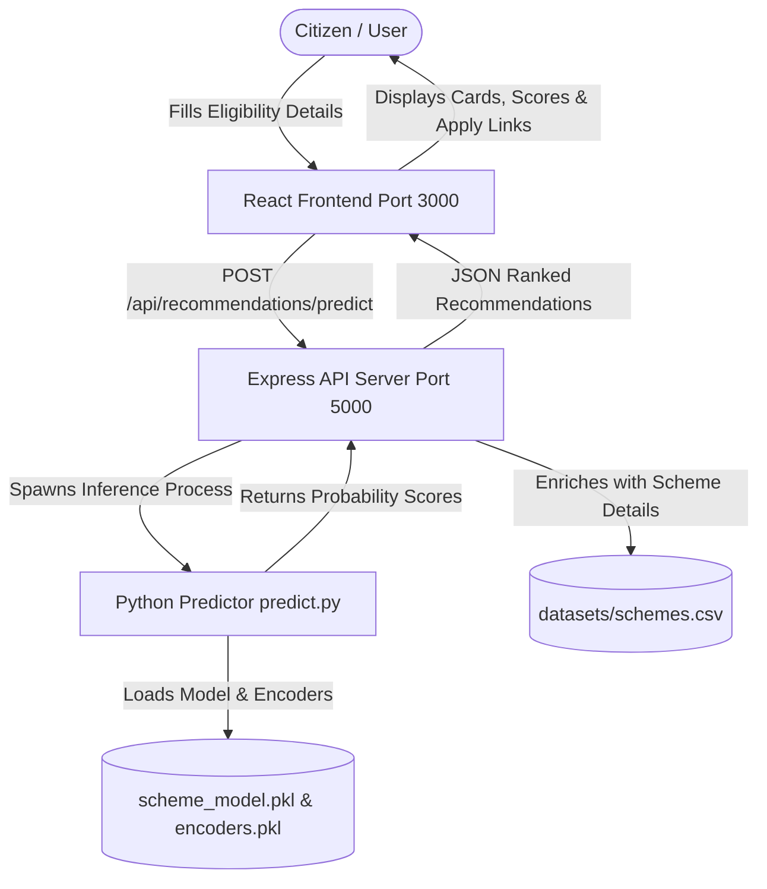

# 🏛️ AI-Powered Government Scheme Recommendation System

[](https://reactjs.org/)
[](https://nodejs.org/)
[](https://scikit-learn.org/)
[](https://tailwindcss.com/)
[](https://opensource.org/licenses/MIT)

An end-to-end web platform and Machine Learning system that evaluates citizen eligibility and recommends applicable Indian Central and State government welfare schemes in real-time.

---

## 📌 Table of Contents
- [Overview](#-overview)
- [Key Features](#-key-features)
- [System Architecture](#-system-architecture)
- [Tech Stack](#-tech-stack)
- [Directory Structure](#-directory-structure)
- [Getting Started](#-getting-started)
  - [Prerequisites](#prerequisites)
  - [1. Backend Setup](#1-backend-setup)
  - [2. Frontend Setup](#2-frontend-setup)
  - [3. ML Model Training & CLI](#3-ml-model-training--cli)
- [API Documentation](#-api-documentation)
- [Machine Learning Engine](#-machine-learning-engine)
- [Available Government Schemes](#-available-government-schemes)
- [Troubleshooting](#-troubleshooting)
- [License](#-license)

---

## 🎯 Overview

Citizens often struggle to discover and navigate hundreds of welfare programs launched by various government ministries. This project simplifies citizen access by providing a **direct eligibility assessment form**:
1. Users enter their demographic and financial profile (Age, Income, Occupation, State, Category, Farmer/Student/Disability status).
2. The **Random Forest Classifier** evaluates user features against eligibility thresholds and historical patterns.
3. The platform displays ranked scheme recommendations with:
   - **Eligibility & Match Score (%)**
   - **Financial and Social Benefits**
   - **Clear qualification explanations** (*"Age Eligible"*, *"Farmer Priority Scheme"*, *"Income within threshold"*)
   - **Required documentation**
   - **Direct links to official application portals**

---

## 🚀 Key Features

- **⚡ Instant Eligibility Check**: Single-screen form with real-time feedback—no mandatory account creation or login required.
- **🧪 One-Click Demo Profiles**: Quick presets for Small Farmers, College Students, Rural Artisans, and Unorganized Workers to test instantly.
- **🤖 Machine Learning Scoring**: Scikit-Learn Random Forest Classifier calculating probability match scores for each scheme.
- **📋 Rule-Based Dual Validation**: Combines ML probabilities with strict age caps and income ceilings from government guidelines.
- **🎯 Transparency & Explainability**: Displays bulleted justification for why each scheme was recommended.
- **🔗 Direct Government Portal Integration**: Direct outbound links to apply on official portals (`pmkisan.gov.in`, `scholarships.gov.in`, `ayushman.gov.in`, etc.).

---

## 🏗️ System Architecture



---

## 🛠️ Tech Stack

### Frontend
- **React 18** (Single Page Application)
- **Tailwind CSS** (Utility-first styling)
- **React Feather** (Icons)
- **React Toastify** (Notifications)
- **Axios** (HTTP Client)

### Backend
- **Node.js** & **Express.js** (REST API)
- **CORS**, **Helmet** (Security headers)
- **csv-parser** & **csv-writer** (CSV data store)
- **Child Process Execution** (Python ML pipeline bridge)

### Machine Learning & Data
- **Python 3.10+ / 3.14**
- **Scikit-learn** (`RandomForestClassifier`, `LabelEncoder`, `train_test_split`)
- **Pandas** & **NumPy** (Data cleaning & feature engineering)
- **Joblib** (Model serialization)

---

## 📁 Directory Structure

```
Government Scheme Recommandation/
├── data_analysis/              # Data Preprocessing, EDA & Modeling Lifecycle
│   ├── README.md               # Data Analysis Master Guide
│   ├── 01_data_profiling.py    # Raw data ingestion & profiling
│   ├── 02_eda.py               # Exploratory Data Analysis & visual generation
│   ├── 03_data_preprocessing.py# Data cleaning, outlier clipping & encoding
│   ├── 04_feature_engineering.py # Feature importance & Gini analysis
│   ├── 05_model_comparison.py  # Multi-model benchmark & evaluation
│   ├── notebooks/              # Interactive Jupyter notebooks
│   │   ├── README.md
│   │   └── EDA_Full_Analysis.ipynb
│   ├── outputs/                # 21 visual charts & processed datasets
│   │   └── README.md
│   └── reports/                # Analytical text summaries
│       └── README.md
│
├── client/                     # React 18 Frontend Application
│   ├── README.md               # Frontend Architecture & UI Process Guide
│   ├── public/
│   │   └── index.html
│   ├── src/
│   │   ├── components/         # Chatbot, Navbar, Footer
│   │   ├── pages/              # Home, Dashboard, Profile, Recommendations
│   │   ├── services/api.js     # Axios API client
│   │   └── App.js              # Routing & toast setup
│   ├── package.json
│   └── tailwind.config.js
│
├── server/                     # Node.js / Express.js Backend API
│   ├── README.md               # Backend API Architecture & Route Guide
│   ├── controllers/            # Recommendation, Auth, Scheme, Admin
│   ├── middleware/             # JWT auth middleware
│   ├── routes/                 # Express REST endpoints
│   ├── server.js               # Entry point (Port 5000)
│   ├── package.json
│   └── .env
│
├── ml_model/                   # Machine Learning Engine & Python Bridge
│   ├── README.md               # ML Model Training & Inference Guide
│   ├── train_model.py          # Random Forest training pipeline
│   ├── predict.py              # CLI inference engine invoked by backend
│   ├── requirements.txt        # Python package dependencies
│   ├── scheme_model.pkl        # Serialized Random Forest model
│   ├── encoders.pkl            # Serialized LabelEncoders
│   └── model_config.json       # Feature configuration & hyperparameters
│
├── datasets/                   # Master Operational Datastore
│   ├── README.md               # Datasets Schema Specification & Guide
│   ├── schemes.csv             # Government welfare schemes catalog
│   ├── users.csv               # Registered citizen accounts
│   └── *.csv                   # Admins, applications, documents, feedback, etc.
│
├── models/                     # Shared Model Repository
│   ├── README.md               # Model Artifacts Store Guide
│   ├── scheme_model.pkl
│   ├── encoders.pkl
│   └── model_config.json
│
└── scheme-recommender/         # Research Prototype & 1500-Profile Benchmark Data
    ├── README.md               # Benchmark Dataset Guide
    ├── users.csv               # 1,500 labeled citizen training records
    ├── schemes.csv             # Reference scheme catalog
    ├── model.py                # Prototype script
    ├── encoders.pkl
    └── scheme_model.pkl
```

---

## 📖 Process Documentation Guides

Each component and process in the project has a dedicated, self-contained documentation guide:

| Process / Component | Process Guide | Scope & Responsibilities |
|---|---|---|
| **Data Analysis & EDA** | [data_analysis/README.md](file:///c:/Developer/Projects/Government%20Scheme%20Recommandation/data_analysis/README.md) | Data profiling, 15 EDA charts, preprocessing, feature engineering & model benchmarking |
| **Interactive Notebooks** | [data_analysis/notebooks/README.md](file:///c:/Developer/Projects/Government%20Scheme%20Recommandation/data_analysis/notebooks/README.md) | Step-by-step Jupyter analysis workflow (`EDA_Full_Analysis.ipynb`) |
| **Analytical Reports** | [data_analysis/reports/README.md](file:///c:/Developer/Projects/Government%20Scheme%20Recommandation/data_analysis/reports/README.md) | Interpretation guide for profiling, EDA, preprocessing, and model comparison reports |
| **Visuals & Processed Data** | [data_analysis/outputs/README.md](file:///c:/Developer/Projects/Government%20Scheme%20Recommandation/data_analysis/outputs/README.md) | Complete catalog of 21 statistical plots and output training matrices |
| **Machine Learning Engine** | [ml_model/README.md](file:///c:/Developer/Projects/Government%20Scheme%20Recommandation/ml_model/README.md) | Random Forest model training, inference interface (`predict.py`), and hyperparameters |
| **Backend API Server** | [server/README.md](file:///c:/Developer/Projects/Government%20Scheme%20Recommandation/server/README.md) | Express REST endpoints, Python child process IPC, CSV datastore operations, and security |
| **Frontend Web Client** | [client/README.md](file:///c:/Developer/Projects/Government%20Scheme%20Recommandation/client/README.md) | React 18 UI components, citizen profile form, preset demo archetypes, and Chart.js |
| **Datasets & Schemas** | [datasets/README.md](file:///c:/Developer/Projects/Government%20Scheme%20Recommandation/datasets/README.md) | Schema specifications for all 11 CSV flat-file database tables |
| **Model Artifacts Store** | [models/README.md](file:///c:/Developer/Projects/Government%20Scheme%20Recommandation/models/README.md) | Production model binaries and categorical encoder artifact specifications |
| **Research & Benchmark Data** | [scheme-recommender/README.md](file:///c:/Developer/Projects/Government%20Scheme%20Recommandation/scheme-recommender/README.md) | 1,500-sample benchmark dataset documentation and research prototype reference |

---

## ⚡ Getting Started

### Prerequisites
- **Node.js** (v18 or higher)
- **npm** (v9 or higher)
- **Python** (v3.9 or higher with `pip`)

---

### 1️⃣ Backend Setup

```bash
cd server
npm install
npm start
```
> The API server will start on **`http://localhost:5000`**.  
> Test health: `GET http://localhost:5000/api/health`

---

### 2️⃣ Frontend Setup

In a new terminal:
```bash
cd client
npm install
npm start
```
> The React dev server will open at **`http://localhost:3000`**.

---

### 3️⃣ ML Model Training & CLI

In a new terminal:
```bash
cd ml_model
pip install -r requirements.txt

# Train the Random Forest Model
python train_model.py

# Test CLI Prediction
python predict.py "{\"age\": 35, \"income\": 80000, \"occupation\": \"Farmer\", \"farmer_status\": \"Yes\"}"
```

---

## 🔌 API Documentation

### **Generate Scheme Recommendations**
Evaluates user eligibility and returns ranked scheme recommendations.

- **Endpoint:** `POST /api/recommendations/predict` (also available via `POST /api/recommendations/generate`)
- **Headers:** `Content-Type: application/json`
- **Authentication:** None (Public Endpoint)

#### **Request Body**
```json
{
  "age": 32,
  "annual_income": 80000,
  "gender": "Male",
  "occupation": "Farmer",
  "education": "10th Pass",
  "category": "OBC",
  "state": "Maharashtra",
  "disability_status": "No",
  "farmer_status": "Yes",
  "student_status": "No",
  "employment_status": "Self-Employed"
}
```

#### **Response (200 OK)**
```json
{
  "message": "Recommendations generated successfully",
  "userProfile": {
    "age": 32,
    "income": 80000,
    "gender": "Male",
    "occupation": "Farmer",
    "state": "Maharashtra",
    "farmer_status": "Yes"
  },
  "totalSchemes": 10,
  "eligibleCount": 8,
  "recommendations": [
    {
      "scheme_id": "1",
      "scheme_name": "PM Kisan Samman Nidhi",
      "department": "Ministry of Agriculture",
      "benefits": "₹6000 annually",
      "recommendationScore": 96,
      "isEligible": true,
      "official_website": "https://pmkisan.gov.in",
      "required_documents": "Aadhar, Bank Details",
      "explanation": [
        "Age Eligible (0-100 yrs)",
        "Income below limit (₹2,500,000)",
        "High Match: Farmer Priority Scheme",
        "Random Forest ML Model Match: 96%"
      ]
    }
  ]
}
```

---

## 🧠 Machine Learning Engine

### Features Evaluated
The model ingests 11 demographic and economic features:
1. `age` (Numeric)
2. `income` (Numeric, annual household income in INR)
3. `gender` (Categorical: Male, Female, Other, All)
4. `occupation` (Categorical: Farmer, Student, Artisan, Worker, etc.)
5. `education` (Categorical: Illiterate, 10th, 12th, Graduate, Post Graduate)
6. `category` (Categorical: General, OBC, SC, ST, EWS)
7. `state` (Categorical: Resident state)
8. `disability_status` (Categorical: Yes/No)
9. `farmer_status` (Categorical: Yes/No)
10. `student_status` (Categorical: Yes/No)
11. `employment_status` (Categorical: Employed, Self-Employed, Unemployed)

### Model Pipeline
1. **Preprocessing**: Label encoding for categorical columns with safe fallback handling for unseen labels.
2. **Classifier**: Scikit-Learn `RandomForestClassifier(n_estimators=100, max_depth=15, min_samples_split=5)`.
3. **Probability Scoring**: `predict_proba()` calculates multi-class probability scores across all registered schemes.
4. **Hybrid Rule Check**: Cross-references physical bounds (`min_age`, `max_age`, `income_limit`) with model probabilities to guarantee 100% compliance with government eligibility criteria.

---

## 📜 Available Government Schemes (Catalog)

| Scheme Name | Ministry | Target Beneficiary | Key Benefit |
|---|---|---|---|
| **PM Kisan Samman Nidhi** | Ministry of Agriculture | Farmers & Landowners | ₹6,000 / year direct benefit transfer |
| **Pradhan Mantri Fasal Bima Yojana** | Ministry of Agriculture | Farmers / Crop Growers | Subsidized crop insurance |
| **Kisan Credit Card Scheme** | Ministry of Agriculture | Farmers | Concessional credit facility |
| **PM Vishwakarma Scheme** | Ministry of MSME | Traditional Artisans & Craftsmen | Up to ₹3 Lakh low-interest loan |
| **National Scholarship Scheme** | Ministry of Education | Students (Merit/Means) | ₹500 - ₹5,000 monthly financial aid |
| **Pradhan Mantri Awas Yojana** | Ministry of Housing | Economically Weaker Sections | Housing construction subsidy |
| **Ayushman Bharat Scheme** | Ministry of Health | Low-income & BPL Families | ₹5 Lakh cashless health cover / year |
| **Beti Bachao Beti Padhao** | Ministry of Women & Child | Girl Children & Female Students | Education & welfare support |
| **MGNREGA Scheme** | Ministry of Rural Development | Rural Citizens | 100 days guaranteed wage employment |
| **PM Shram Yogi Maandhan** | Ministry of Labour | Unorganized Workers | ₹3,000 monthly pension post-60 |

---

## 🛠️ Troubleshooting

### 1. Port 5000 or 3000 Already in Use
- **Windows (PowerShell):**
  ```powershell
  Get-Process -Id (Get-NetTCPConnection -LocalPort 5000).OwningProcess | Stop-Process -Force
  Get-Process -Id (Get-NetTCPConnection -LocalPort 3000).OwningProcess | Stop-Process -Force
  ```

### 2. Python Unicode Console Error on Windows
Set UTF-8 encoding in PowerShell:
```powershell
$env:PYTHONIOENCODING="utf-8"
python train_model.py
```

### 3. Missing Frontend Icons or Dependencies
Install with legacy peer dependencies:
```bash
cd client
npm install react-feather --legacy-peer-deps
```

---

## 📄 License
This project is licensed under the [MIT License](LICENSE).
